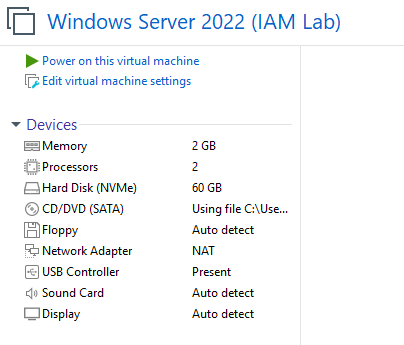
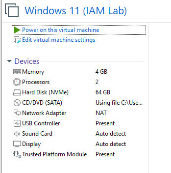
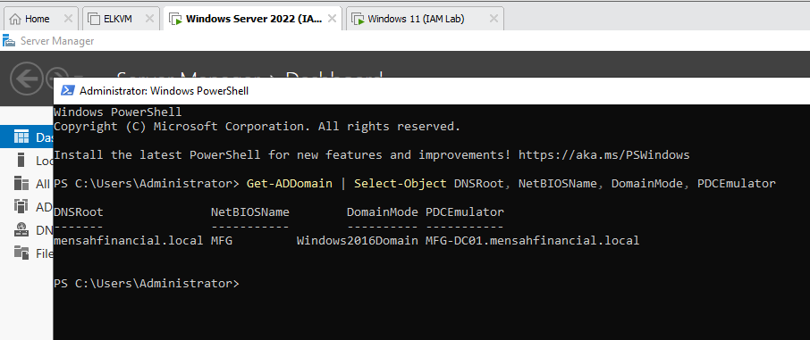
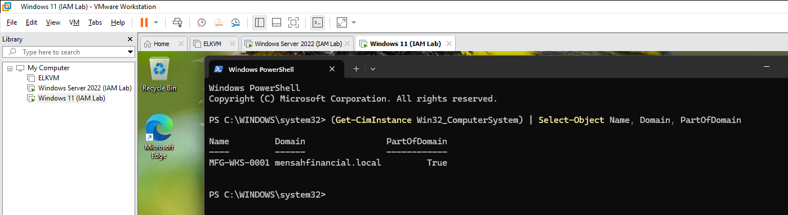

# Phase 0: Environment setup

[Back to main README](../README.md) | Next: [Phase 1: Identity foundation](../01-identity-foundation/README.md)

**Goal:** build the on-premises side of Mensah Financial Group (a Windows domain with a domain controller and a joined workstation) and the cloud tenant it will connect to, before any identity work starts.

**Status:** Environment established; the original build steps were not recorded. Final-state verification screenshots are provided.

## What was set up

| Component | Role | OS | Resources |
|---|---|---|---|
| `MFG-DC01` | Domain controller and DNS | Windows Server 2022 | 2 vCPU, 2 GB RAM, 60 GB NVMe |
| `MFG-WKS-0001` | Domain-joined workstation | Windows 11 | 2 vCPU, 4 GB RAM, 64 GB NVMe, vTPM |
| Tenant | Cloud identity | Microsoft Entra ID | `MensahFinancialGroup.onmicrosoft.com`, display name "IAM Lab" |

Both machines are virtual machines in **VMware Workstation** on one host, on a **NAT** network. The tenant started on a Microsoft 365 E5 trial (25 licences), which provided the Entra ID P2 features used in later phases. The trial ended on Oct 16, 2026, and the tenant now runs Entra ID Free.

The VMware settings for each machine:


*`MFG-DC01`: 2 GB memory, 2 processors, 60 GB NVMe disk, NAT network adapter.*


*`MFG-WKS-0001`: 4 GB memory, 2 processors, 64 GB NVMe disk, NAT network adapter, virtual TPM present.*

| Network setting | Value |
|---|---|
| Virtual network | VMware NAT, both machines |
| Workstation DNS server | The domain controller `MFG-DC01` |

## The on-premises domain

`MFG-DC01` runs Active Directory Domain Services and DNS for the domain `mensahfinancial.local` (NetBIOS name `MFG`). This command on the domain controller confirms the domain and that `MFG-DC01` holds the PDC emulator role:

```powershell
Get-ADDomain | Select-Object DNSRoot, NetBIOSName, DomainMode, PDCEmulator
```


*The domain is `mensahfinancial.local`, NetBIOS `MFG`, at Windows Server 2016 domain functional level, with `MFG-DC01` as PDC emulator. The VMware tabs at the top show both lab VMs running.*

The on-premises domain uses the internal DNS name `mensahfinancial.local`. This namespace is not a publicly verifiable internet domain, so it cannot be added to the tenant as a verified custom domain. In [Phase 3](../03-hybrid-identity/README.md), an alternate UPN suffix based on the tenant's `onmicrosoft.com` domain is used for synchronized users' cloud sign-in names. This lets the lab keep its internal AD domain while using a cloud-compatible sign-in suffix.

## The domain-joined workstation

`MFG-WKS-0001` is joined to `mensahfinancial.local`. This command on the workstation confirms it:

```powershell
(Get-CimInstance Win32_ComputerSystem) | Select-Object Name, Domain, PartOfDomain
```


*`MFG-WKS-0001` reports `Domain: mensahfinancial.local` and `PartOfDomain: True`. The VMware library on the left lists the two lab VMs.*

This on-premises join is the starting point for [Phase 3](../03-hybrid-identity/README.md), where the same workstation is registered with Entra ID as a hybrid joined device.

## Lessons from this phase

- **DNS ties the workstation to the domain controller.** The workstation uses the domain controller as its DNS server. With the DC powered off, the workstation lost name resolution, so domain sign-in failed and so did cloud connections, including Microsoft Graph PowerShell ([Phase 5](../05-monitoring-and-workload-identity/README.md)). Graph does not need a domain controller itself; the failure was a symptom of this lab's DNS dependency. Power on the DC before working on the workstation, and check DNS first when sign-in or a cloud connection fails.
- **Resources are modest on purpose.** 2 GB for the domain controller is enough for a small lab domain. It is not a production sizing.

## Notes

- The tenant's evidence for P2 features was captured during the trial, as the main README explains.
- Another VM in the VMware library (`ELKVM`) belongs to a different project and is not part of this lab.
