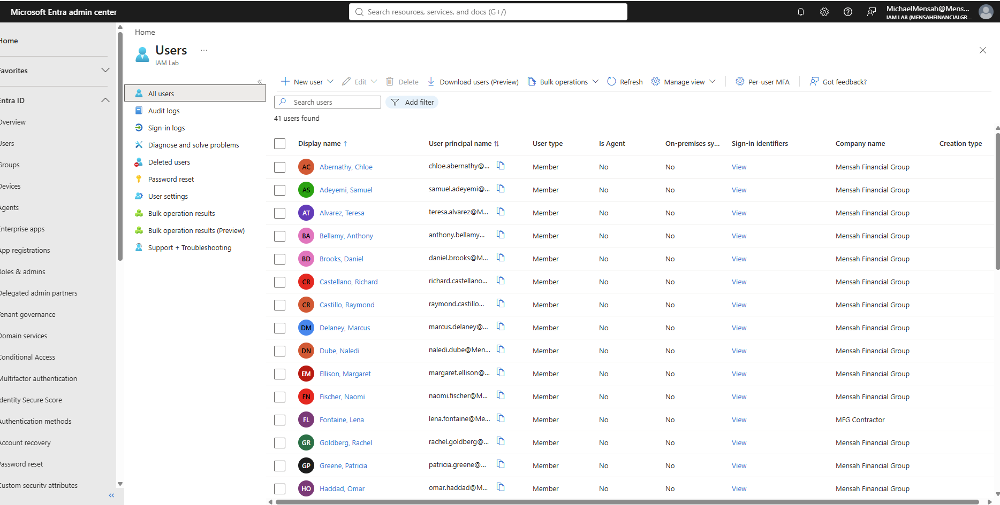
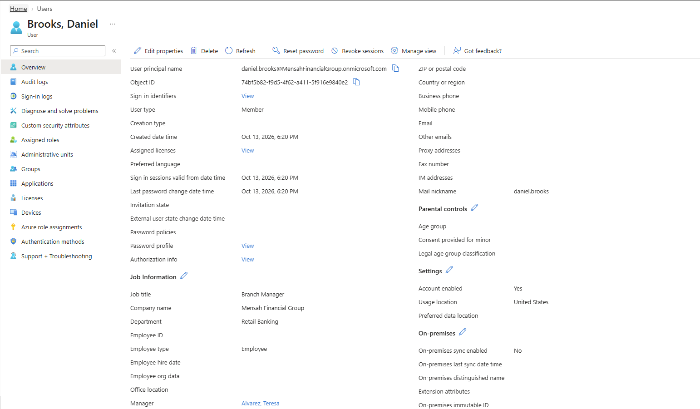
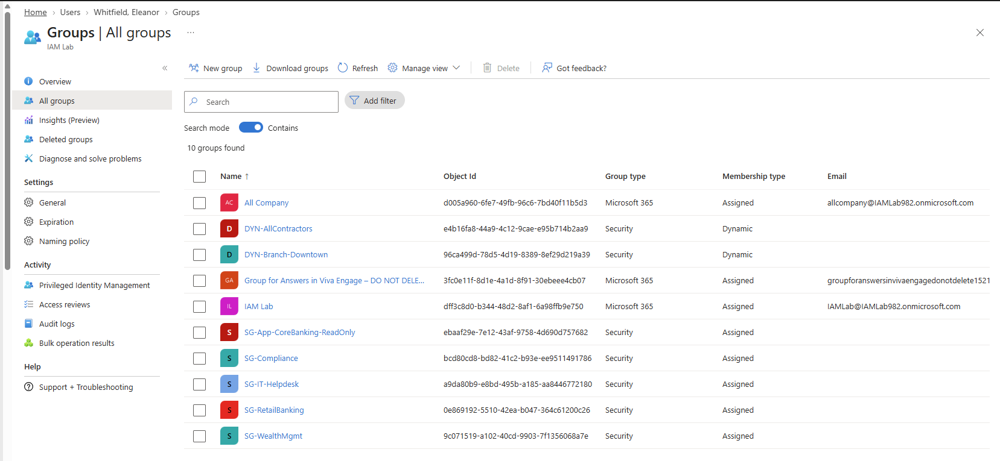
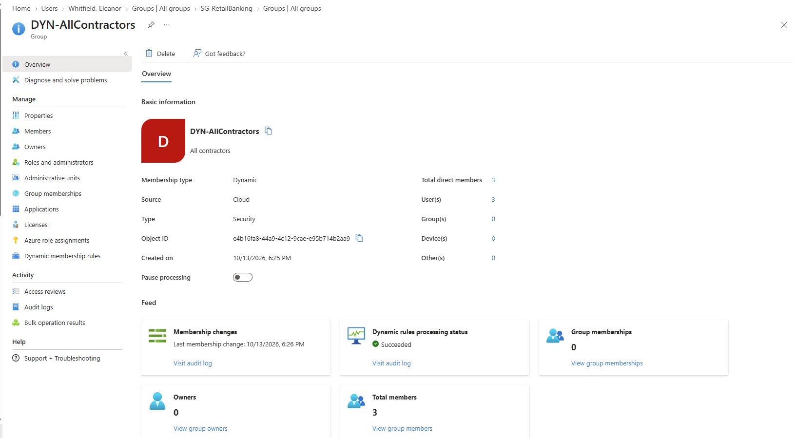
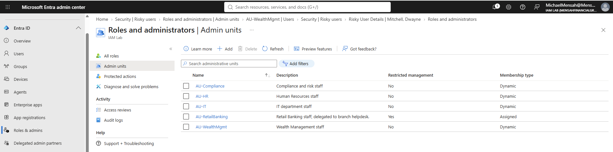
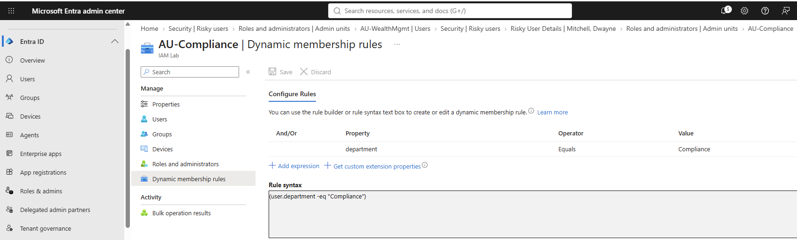
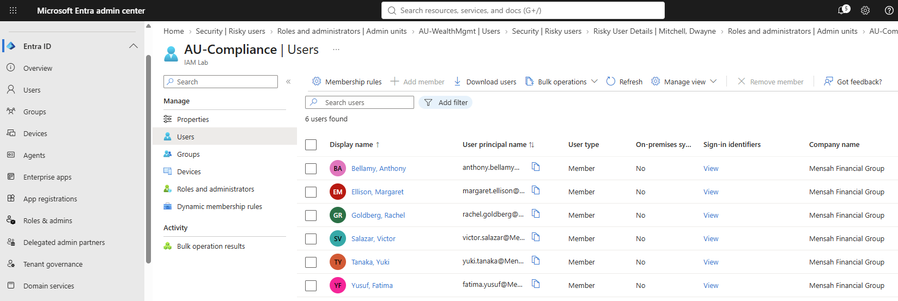
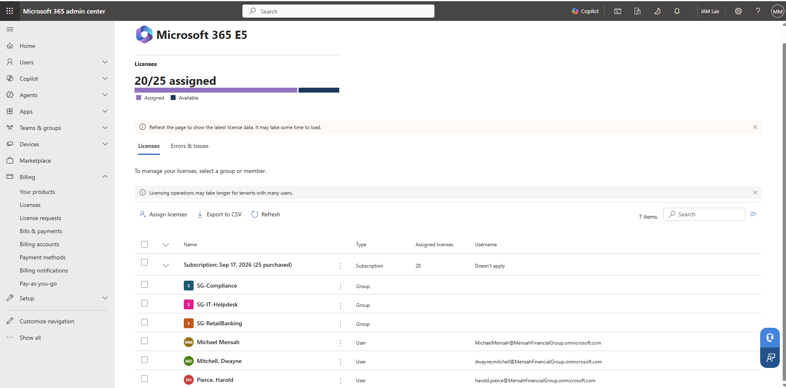
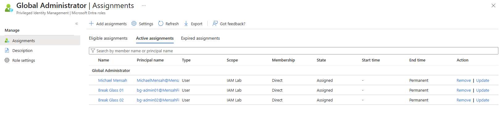

# Phase 1: Identity foundation

[Back to main README](../README.md) | Previous: [Phase 0](../00-environment-setup/README.md) | Next: [Phase 2: Authentication and access control](../02-authentication-and-access/README.md)

**Goal:** turn the bank's organization chart into identities: every employee gets an account with a title, department, location and manager; groups and administrative units reflect how the bank is organized; licences follow group membership; and emergency access exists before any policy is built.

**Status:** Configuration complete for this phase; validation varies by component. Items marked *Configured* were set up but not tested end to end. Licensing evidence reflects the Microsoft 365 E5 trial, which ended on October 16, 2026.

## Summary of what was built

| Area | Result | Evidence status |
|---|---|---|
| Users | 40 users created from a CSV by script, plus the admin account (41 in the tenant) | Tested |
| Managers | Defined for 39 of the 40 users in the CSV (the CEO has no manager) and set by the script | Verified on one profile; the other 38 were not individually checked |
| Groups | 3 department groups, an IT helpdesk group, a core banking app group | Tested |
| Dynamic groups | `DYN-AllContractors` and `DYN-Branch-Downtown` | Tested (`DYN-AllContractors` populated with 3 members) |
| Administrative units | 4 dynamic AUs by department, 1 restricted management AU for Retail Banking | Dynamic membership tested (`AU-Compliance` populated with 6 users). Restricted delegation configured; allowed and denied actions not tested |
| Licensing | Group-based licensing for three groups; 20 of 25 licences were assigned during the trial (now disabled) | Tested during the trial |
| Emergency access | 2 break-glass Global Administrators, permanent | Configured (no recovery sign-in test) |

## 1. Users, created by script

The organization is defined in a CSV, [`mfg_users.csv`](mfg_users.csv), with one row per person: name, title, department, city, employee type, usage location and manager. The script `New-MFGOrg.ps1` reads it with Microsoft Graph PowerShell and creates each account, then sets managers, then creates the groups. It prompts for the temporary password at run time (it is never stored in the repo) and forces a password change at first sign-in. It also skips users that already exist, so it can be re-run.

| Department | Users |
|---|---|
| Executive | 4 |
| Retail Banking | 9 |
| Wealth Management | 7 |
| Compliance | 6 |
| IT | 9 |
| HR | 5 |


*41 users in the tenant: the 40 from the CSV plus the admin account.*


*One profile: Branch Manager, Retail Banking, Mensah Financial Group, usage location United States, manager Teresa Alvarez.*

<details>
<summary>The script: <code>New-MFGOrg.ps1</code> (click to expand)</summary>

This is the **original version of the script**, as it was run. The tenant ID is replaced with a placeholder. It sets every user's company name to "Mensah Financial Group" and its contractor rule uses `employeeType`, which was rejected in this lab. The contractor fix described in section 3 was made afterwards, in the portal, and is not in this script. The script skips users that already exist and does not update their attributes, so re-running it will not correct existing accounts.

```powershell
# New-MFGOrg.ps1
# Builds the Mensah Financial Group org in MensahFinancialGroup.onmicrosoft.com:
#   1) 40 users from mfg_users.csv
#   2) manager relationships
#   3) department security groups + app group + helpdesk group
#   4) dynamic groups (contractors, Downtown branch)
#
# Run from the folder containing mfg_users.csv, in PowerShell 7 (or Windows PowerShell 5.1).
# Prereq (once): Install-Module Microsoft.Graph -Scope CurrentUser
# Sign in as your Global Admin when the browser prompt appears.

$ErrorActionPreference = "Stop"

Connect-MgGraph -TenantId "<your-tenant-id>" `
    -Scopes "User.ReadWrite.All","Group.ReadWrite.All","Directory.ReadWrite.All"

# One temporary password for all lab users; each must change it at first sign-in.
$secure = Read-Host "Temporary password for new users (e.g. a long random one)" -AsSecureString
$plain  = [Runtime.InteropServices.Marshal]::PtrToStringAuto(
            [Runtime.InteropServices.Marshal]::SecureStringToBSTR($secure))
$pwProfile = @{ Password = $plain; ForceChangePasswordNextSignIn = $true }

$users = Import-Csv -Path ".\mfg_users.csv"

# ---------- 1) Users ----------
foreach ($u in $users) {
    $existing = Get-MgUser -Filter "userPrincipalName eq '$($u.UserPrincipalName)'" -ErrorAction SilentlyContinue
    if ($existing) { Write-Host "SKIP (exists): $($u.UserPrincipalName)"; continue }

    New-MgUser -AccountEnabled:$true `
        -DisplayName       $u.DisplayName `
        -GivenName         $u.GivenName `
        -Surname           $u.Surname `
        -MailNickname      $u.MailNickname `
        -UserPrincipalName $u.UserPrincipalName `
        -JobTitle          $u.JobTitle `
        -Department        $u.Department `
        -City              $u.City `
        -CompanyName       "Mensah Financial Group" `
        -EmployeeType      $u.EmployeeType `
        -UsageLocation     $u.UsageLocation `
        -PasswordProfile   $pwProfile | Out-Null
    Write-Host "Created: $($u.UserPrincipalName)"
}

# ---------- 2) Managers ----------
foreach ($u in ($users | Where-Object { $_.ManagerUPN })) {
    $mgr = Get-MgUser -UserId $u.ManagerUPN
    $ref = @{ "@odata.id" = "https://graph.microsoft.com/v1.0/users/$($mgr.Id)" }
    Set-MgUserManagerByRef -UserId $u.UserPrincipalName -BodyParameter $ref
    Write-Host "Manager set: $($u.UserPrincipalName) -> $($u.ManagerUPN)"
}

# ---------- 3) Assigned security groups ----------
function Ensure-SecurityGroup($name, $nick, $description) {
    $g = Get-MgGroup -Filter "displayName eq '$name'" -ErrorAction SilentlyContinue
    if (-not $g) {
        $g = New-MgGroup -DisplayName $name -MailNickname $nick -Description $description `
                -MailEnabled:$false -SecurityEnabled:$true
        Write-Host "Group created: $name"
    }
    return $g
}

function Add-Members($group, $upns) {
    foreach ($upn in $upns) {
        $id = (Get-MgUser -UserId $upn).Id
        try { New-MgGroupMember -GroupId $group.Id -DirectoryObjectId $id }
        catch { if ($_.Exception.Message -notmatch "already exist") { throw } }
    }
}

$deptGroups = @{
    "Retail Banking"    = "SG-RetailBanking"
    "Wealth Management" = "SG-WealthMgmt"
    "Compliance"        = "SG-Compliance"
}
foreach ($dept in $deptGroups.Keys) {
    $g = Ensure-SecurityGroup $deptGroups[$dept] ($deptGroups[$dept] -replace '-','') "Department group: $dept"
    Add-Members $g ($users | Where-Object Department -eq $dept).UserPrincipalName
}

# Helpdesk group = IT users with Helpdesk in the title
$helpdesk = Ensure-SecurityGroup "SG-IT-Helpdesk" "SGITHelpdesk" "IT helpdesk technicians"
Add-Members $helpdesk ($users | Where-Object { $_.Department -eq "IT" -and $_.JobTitle -like "*Helpdesk*" }).UserPrincipalName

# App access group = Retail Banking
$coreBanking = Ensure-SecurityGroup "SG-App-CoreBanking-ReadOnly" "SGAppCoreBankingRO" "Read-only access to the core banking app"
Add-Members $coreBanking ($users | Where-Object Department -eq "Retail Banking").UserPrincipalName

# ---------- 4) Dynamic security groups (require Entra ID P1/P2) ----------
function Ensure-DynamicGroup($name, $nick, $rule, $description) {
    $g = Get-MgGroup -Filter "displayName eq '$name'" -ErrorAction SilentlyContinue
    if (-not $g) {
        New-MgGroup -DisplayName $name -MailNickname $nick -Description $description `
            -MailEnabled:$false -SecurityEnabled:$true `
            -GroupTypes @("DynamicMembership") `
            -MembershipRule $rule -MembershipRuleProcessingState "On" | Out-Null
        Write-Host "Dynamic group created: $name"
    }
}
Ensure-DynamicGroup "DYN-AllContractors"   "DYNAllContractors"  '(user.employeeType -eq "Contractor")' "All contractors"
Ensure-DynamicGroup "DYN-Branch-Downtown"  "DYNBranchDowntown"  '(user.city -eq "Downtown")'           "Downtown branch staff"

Write-Host "`nDone. Dynamic group membership can take a few minutes to populate."
Disconnect-MgGraph | Out-Null
```

</details>

<details>
<summary>The roster: <code>mfg_users.csv</code> (click to expand)</summary>

```csv
DisplayName,GivenName,Surname,MailNickname,UserPrincipalName,JobTitle,Department,City,EmployeeType,UsageLocation,ManagerUPN
"Whitfield, Eleanor",Eleanor,Whitfield,eleanor.whitfield,eleanor.whitfield@MensahFinancialGroup.onmicrosoft.com,Chief Executive Officer,Executive,Corporate,Employee,US,
"Delaney, Marcus",Marcus,Delaney,marcus.delaney,marcus.delaney@MensahFinancialGroup.onmicrosoft.com,Chief Financial Officer,Executive,Corporate,Employee,US,eleanor.whitfield@MensahFinancialGroup.onmicrosoft.com
"Raman, Priya",Priya,Raman,priya.raman,priya.raman@MensahFinancialGroup.onmicrosoft.com,Chief Risk Officer,Executive,Corporate,Employee,US,eleanor.whitfield@MensahFinancialGroup.onmicrosoft.com
"Okafor, Jonathan",Jonathan,Okafor,jonathan.okafor,jonathan.okafor@MensahFinancialGroup.onmicrosoft.com,Chief Information Officer,Executive,Corporate,Employee,US,eleanor.whitfield@MensahFinancialGroup.onmicrosoft.com
"Alvarez, Teresa",Teresa,Alvarez,teresa.alvarez,teresa.alvarez@MensahFinancialGroup.onmicrosoft.com,Director of Retail Banking,Retail Banking,Downtown,Employee,US,eleanor.whitfield@MensahFinancialGroup.onmicrosoft.com
"Brooks, Daniel",Daniel,Brooks,daniel.brooks,daniel.brooks@MensahFinancialGroup.onmicrosoft.com,Branch Manager,Retail Banking,Downtown,Employee,US,teresa.alvarez@MensahFinancialGroup.onmicrosoft.com
"Fischer, Naomi",Naomi,Fischer,naomi.fischer,naomi.fischer@MensahFinancialGroup.onmicrosoft.com,Branch Manager,Retail Banking,Westside,Employee,US,teresa.alvarez@MensahFinancialGroup.onmicrosoft.com
"Tran, Kevin",Kevin,Tran,kevin.tran,kevin.tran@MensahFinancialGroup.onmicrosoft.com,Personal Banker,Retail Banking,Downtown,Employee,US,daniel.brooks@MensahFinancialGroup.onmicrosoft.com
"Nwosu, Amara",Amara,Nwosu,amara.nwosu,amara.nwosu@MensahFinancialGroup.onmicrosoft.com,Personal Banker,Retail Banking,Downtown,Employee,US,daniel.brooks@MensahFinancialGroup.onmicrosoft.com
"Herrera, Luis",Luis,Herrera,luis.herrera,luis.herrera@MensahFinancialGroup.onmicrosoft.com,Teller Supervisor,Retail Banking,Westside,Employee,US,naomi.fischer@MensahFinancialGroup.onmicrosoft.com
"Kowalski, Hannah",Hannah,Kowalski,hannah.kowalski,hannah.kowalski@MensahFinancialGroup.onmicrosoft.com,Personal Banker,Retail Banking,Westside,Employee,US,naomi.fischer@MensahFinancialGroup.onmicrosoft.com
"Simmons, Derek",Derek,Simmons,derek.simmons,derek.simmons@MensahFinancialGroup.onmicrosoft.com,Loan Officer,Retail Banking,Downtown,Employee,US,daniel.brooks@MensahFinancialGroup.onmicrosoft.com
"Mendes, Sofia",Sofia,Mendes,sofia.mendes,sofia.mendes@MensahFinancialGroup.onmicrosoft.com,Loan Officer,Retail Banking,Westside,Employee,US,naomi.fischer@MensahFinancialGroup.onmicrosoft.com
"Castellano, Richard",Richard,Castellano,richard.castellano,richard.castellano@MensahFinancialGroup.onmicrosoft.com,Director of Wealth Management,Wealth Management,Corporate,Employee,US,marcus.delaney@MensahFinancialGroup.onmicrosoft.com
"Lindholm, Grace",Grace,Lindholm,grace.lindholm,grace.lindholm@MensahFinancialGroup.onmicrosoft.com,Senior Wealth Advisor,Wealth Management,Downtown,Employee,US,richard.castellano@MensahFinancialGroup.onmicrosoft.com
"Haddad, Omar",Omar,Haddad,omar.haddad,omar.haddad@MensahFinancialGroup.onmicrosoft.com,Wealth Advisor,Wealth Management,Downtown,Employee,US,richard.castellano@MensahFinancialGroup.onmicrosoft.com
"Nakamura, Beatrice",Beatrice,Nakamura,beatrice.nakamura,beatrice.nakamura@MensahFinancialGroup.onmicrosoft.com,Wealth Advisor,Wealth Management,Westside,Employee,US,richard.castellano@MensahFinancialGroup.onmicrosoft.com
"Reinhardt, Tobias",Tobias,Reinhardt,tobias.reinhardt,tobias.reinhardt@MensahFinancialGroup.onmicrosoft.com,Portfolio Analyst,Wealth Management,Corporate,Contractor,US,richard.castellano@MensahFinancialGroup.onmicrosoft.com
"Abernathy, Chloe",Chloe,Abernathy,chloe.abernathy,chloe.abernathy@MensahFinancialGroup.onmicrosoft.com,Client Services Associate,Wealth Management,Downtown,Employee,US,grace.lindholm@MensahFinancialGroup.onmicrosoft.com
"Adeyemi, Samuel",Samuel,Adeyemi,samuel.adeyemi,samuel.adeyemi@MensahFinancialGroup.onmicrosoft.com,Estate Planning Specialist,Wealth Management,Westside,Employee,US,richard.castellano@MensahFinancialGroup.onmicrosoft.com
"Ellison, Margaret",Margaret,Ellison,margaret.ellison,margaret.ellison@MensahFinancialGroup.onmicrosoft.com,Chief Compliance Officer,Compliance,Corporate,Employee,US,priya.raman@MensahFinancialGroup.onmicrosoft.com
"Salazar, Victor",Victor,Salazar,victor.salazar,victor.salazar@MensahFinancialGroup.onmicrosoft.com,Compliance Analyst,Compliance,Corporate,Employee,US,margaret.ellison@MensahFinancialGroup.onmicrosoft.com
"Tanaka, Yuki",Yuki,Tanaka,yuki.tanaka,yuki.tanaka@MensahFinancialGroup.onmicrosoft.com,BSA/AML Analyst,Compliance,Corporate,Employee,US,margaret.ellison@MensahFinancialGroup.onmicrosoft.com
"Goldberg, Rachel",Rachel,Goldberg,rachel.goldberg,rachel.goldberg@MensahFinancialGroup.onmicrosoft.com,Internal Auditor,Compliance,Corporate,Employee,US,margaret.ellison@MensahFinancialGroup.onmicrosoft.com
"Bellamy, Anthony",Anthony,Bellamy,anthony.bellamy,anthony.bellamy@MensahFinancialGroup.onmicrosoft.com,Risk Analyst,Compliance,Corporate,Employee,US,priya.raman@MensahFinancialGroup.onmicrosoft.com
"Yusuf, Fatima",Fatima,Yusuf,fatima.yusuf,fatima.yusuf@MensahFinancialGroup.onmicrosoft.com,Regulatory Reporting Specialist,Compliance,Corporate,Employee,US,margaret.ellison@MensahFinancialGroup.onmicrosoft.com
"Castillo, Raymond",Raymond,Castillo,raymond.castillo,raymond.castillo@MensahFinancialGroup.onmicrosoft.com,IT Director,IT,Corporate,Employee,US,jonathan.okafor@MensahFinancialGroup.onmicrosoft.com
"Monroe, Alicia",Alicia,Monroe,alicia.monroe,alicia.monroe@MensahFinancialGroup.onmicrosoft.com,Systems Administrator,IT,Corporate,Employee,US,raymond.castillo@MensahFinancialGroup.onmicrosoft.com
"Pike, Brandon",Brandon,Pike,brandon.pike,brandon.pike@MensahFinancialGroup.onmicrosoft.com,Network Engineer,IT,Corporate,Employee,US,raymond.castillo@MensahFinancialGroup.onmicrosoft.com
"Osei, Janelle",Janelle,Osei,janelle.osei,janelle.osei@MensahFinancialGroup.onmicrosoft.com,Security Analyst,IT,Corporate,Employee,US,raymond.castillo@MensahFinancialGroup.onmicrosoft.com
"Ngo, Tyler",Tyler,Ngo,tyler.ngo,tyler.ngo@MensahFinancialGroup.onmicrosoft.com,Helpdesk Technician,IT,Downtown,Employee,US,raymond.castillo@MensahFinancialGroup.onmicrosoft.com
"Reyes, Monica",Monica,Reyes,monica.reyes,monica.reyes@MensahFinancialGroup.onmicrosoft.com,Helpdesk Technician,IT,Westside,Employee,US,raymond.castillo@MensahFinancialGroup.onmicrosoft.com
"Pierce, Harold",Harold,Pierce,harold.pierce,harold.pierce@MensahFinancialGroup.onmicrosoft.com,Identity and Access Administrator,IT,Corporate,Employee,US,raymond.castillo@MensahFinancialGroup.onmicrosoft.com
"Solheim, Ingrid",Ingrid,Solheim,ingrid.solheim,ingrid.solheim@MensahFinancialGroup.onmicrosoft.com,Database Administrator,IT,Corporate,Employee,US,alicia.monroe@MensahFinancialGroup.onmicrosoft.com
"Mitchell, Dwayne",Dwayne,Mitchell,dwayne.mitchell,dwayne.mitchell@MensahFinancialGroup.onmicrosoft.com,IT Consultant,IT,Corporate,Contractor,US,raymond.castillo@MensahFinancialGroup.onmicrosoft.com
"Greene, Patricia",Patricia,Greene,patricia.greene,patricia.greene@MensahFinancialGroup.onmicrosoft.com,HR Director,HR,Corporate,Employee,US,eleanor.whitfield@MensahFinancialGroup.onmicrosoft.com
"Ibarra, Carlos",Carlos,Ibarra,carlos.ibarra,carlos.ibarra@MensahFinancialGroup.onmicrosoft.com,HR Generalist,HR,Corporate,Employee,US,patricia.greene@MensahFinancialGroup.onmicrosoft.com
"Fontaine, Lena",Lena,Fontaine,lena.fontaine,lena.fontaine@MensahFinancialGroup.onmicrosoft.com,Recruiter,HR,Corporate,Contractor,US,patricia.greene@MensahFinancialGroup.onmicrosoft.com
"Park, Wesley",Wesley,Park,wesley.park,wesley.park@MensahFinancialGroup.onmicrosoft.com,Payroll Specialist,HR,Corporate,Employee,US,patricia.greene@MensahFinancialGroup.onmicrosoft.com
"Dube, Naledi",Naledi,Dube,naledi.dube,naledi.dube@MensahFinancialGroup.onmicrosoft.com,Benefits Coordinator,HR,Corporate,Employee,US,patricia.greene@MensahFinancialGroup.onmicrosoft.com
```

</details>

## 2. Groups

The script creates three department security groups (`SG-RetailBanking`, `SG-WealthMgmt`, `SG-Compliance`), `SG-IT-Helpdesk` (IT staff with "Helpdesk" in their title, 2 people) and `SG-App-CoreBanking-ReadOnly` (Retail Banking staff, for a core banking application). The tenant also has a few default Microsoft 365 groups that are not part of the lab design.


*10 groups: the lab's five security groups, two dynamic groups, and three default Microsoft 365 groups.*

## 3. Dynamic groups

Dynamic groups add and remove members automatically from user attributes. Two were created: `DYN-AllContractors` (rule on company name) and `DYN-Branch-Downtown` (rule on city).

The original contractor rule used `employeeType`, as the script does, and was rejected in this lab. The design was changed: the three contractors (one each in Wealth Management, IT and HR) were given the company name "MFG Contractor", and the rule was rewritten on the company name attribute. The group then populated with three members. These changes were made in the portal after the script ran.


*`DYN-AllContractors`: membership type Dynamic, 3 members, rule processing status Succeeded.*

## 4. Administrative units

Administrative units limit where an admin's role applies. Four units cover departments and use dynamic membership: `AU-Compliance`, `AU-HR`, `AU-IT` and `AU-WealthMgmt`. `AU-RetailBanking` uses assigned membership and has **restricted management** turned on, so only admins scoped to the unit can manage its users. No role assignment for that delegation is shown in this phase's screenshots. The intended delegation is to the branch helpdesk, so that a branch helpdesk technician can manage Retail Banking users only. The administrative unit configuration is shown below. The permission boundary itself (what a scoped technician can and cannot do) was not tested.


*Five units. Only `AU-RetailBanking` has restricted management, and it is the only one with assigned membership.*


*The `AU-Compliance` rule: `(user.department -eq "Compliance")`.*


*The rule populated the unit with the 6 Compliance users.*

## 5. Group-based licensing

Microsoft 365 E5 licences are assigned to groups, not to people, so a new hire gets the right licence by joining the right group. Licences were assigned to `SG-RetailBanking`, `SG-Compliance` and `SG-IT-Helpdesk`, and directly to three accounts (the admin, an IT consultant and the identity administrator). That was 20 of the 25 licences during the trial. Group-based licensing is assigned in the Microsoft 365 admin center, not the Entra admin center. The trial has since ended and the licences are disabled.



## 6. Emergency access (break-glass)

Two cloud-only accounts, `bg-admin01` and `bg-admin02`, hold the Global Administrator role permanently. They are excluded from every Conditional Access policy (see [Phase 2](../02-authentication-and-access/README.md)) and are deliberately not managed by PIM, so a misconfigured policy or a PIM failure cannot lock everyone out of the tenant. They are for emergencies only and were not used for routine administration.


*Active Global Administrator assignments: the two break-glass accounts and the main admin account, all Permanent.*

**Limitations.** The main admin account is also a permanent Global Administrator, which a production tenant would replace with an eligible assignment. No sign-in alert was set up for the break-glass accounts, and a recovery sign-in test was not run. A production tenant would need both.

## Lessons from this phase

- **Dynamic membership rules need validation.** The original contractor rule using `employeeType` was rejected in this lab. I changed the design to use the company-name attribute and confirmed that the contractor group populated with three members. Validate rule syntax and the attributes a rule uses before relying on dynamic membership for access control.
- **Group-based licensing is assigned in the Microsoft 365 admin center.**
- **Data quality drives dynamic membership.** The department and city values written by the script are what the dynamic groups and administrative units evaluate.
