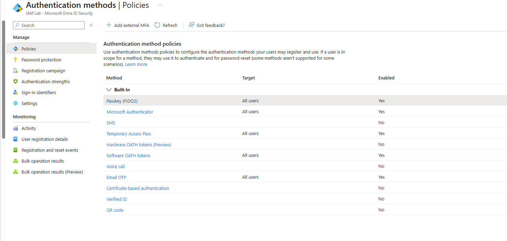
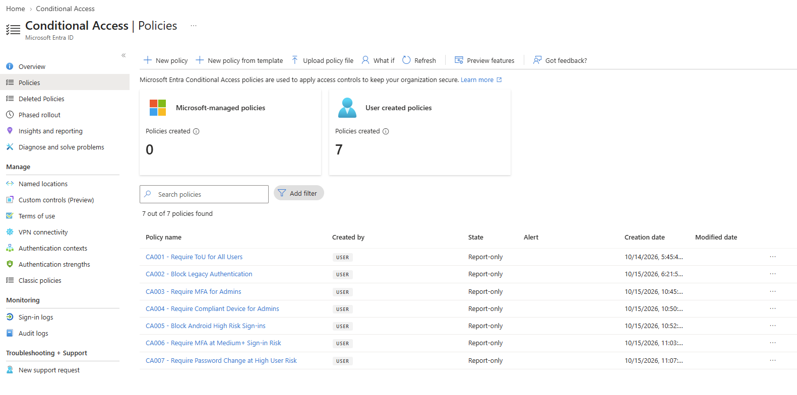
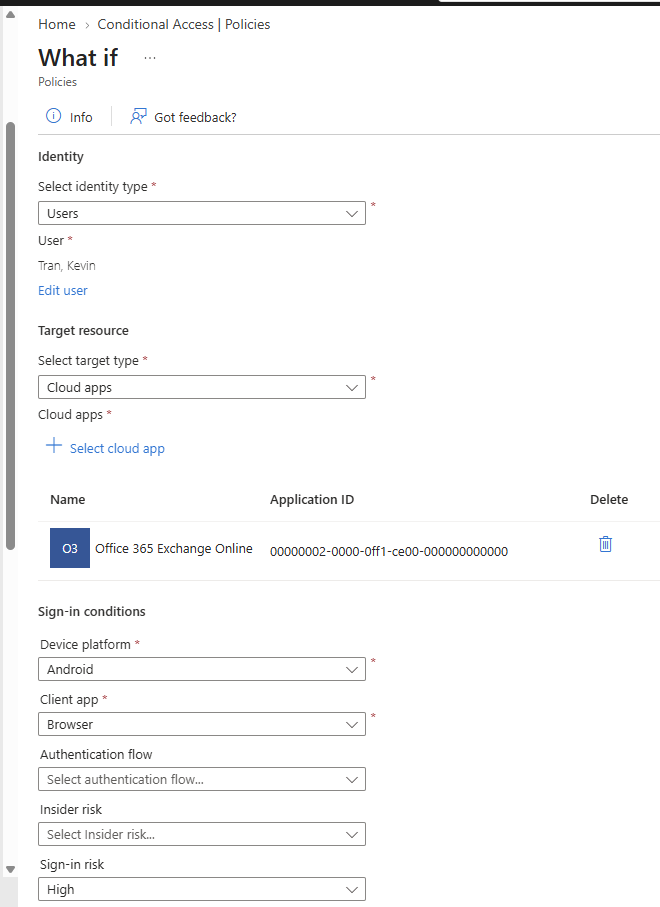
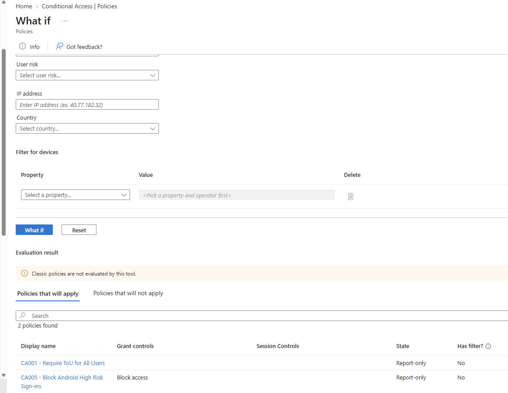
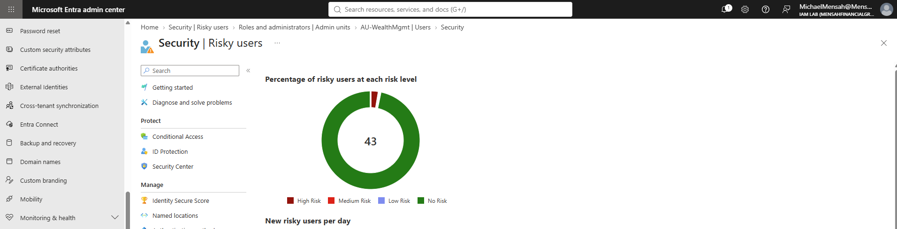
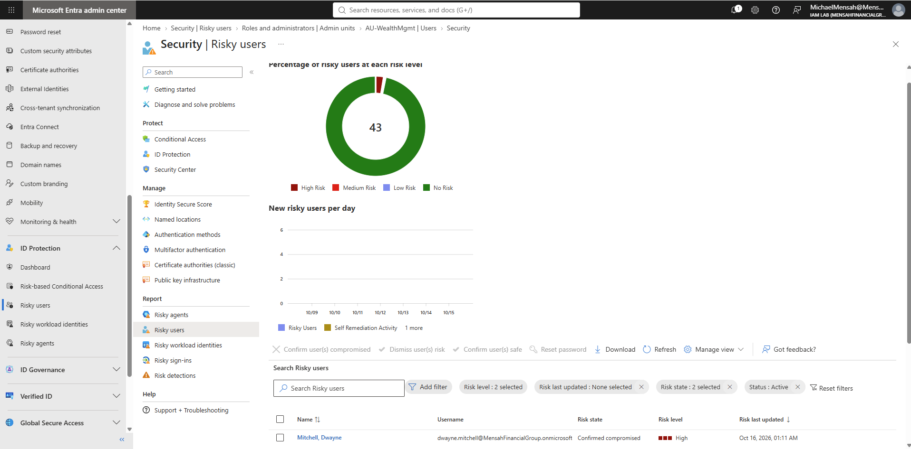
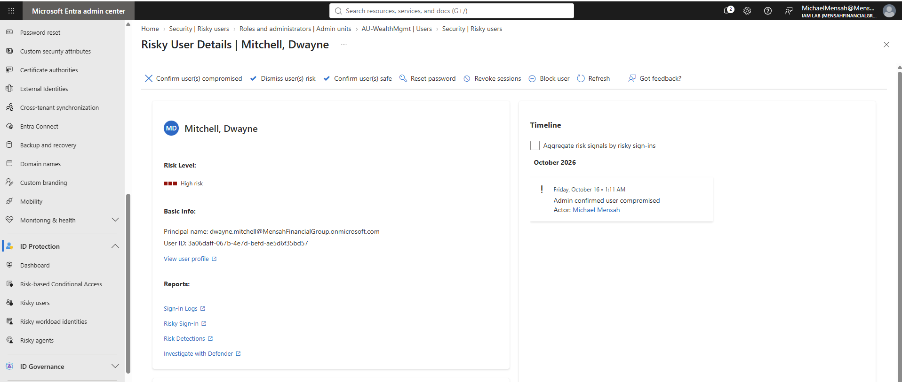
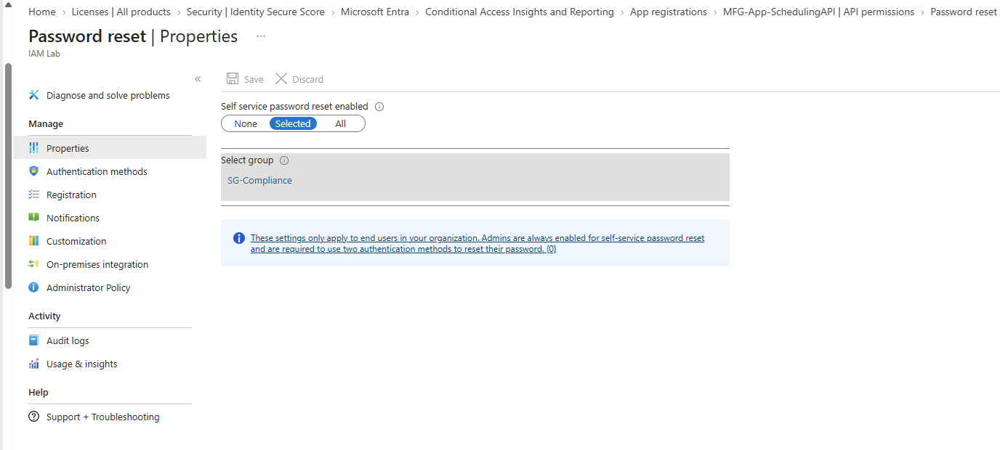
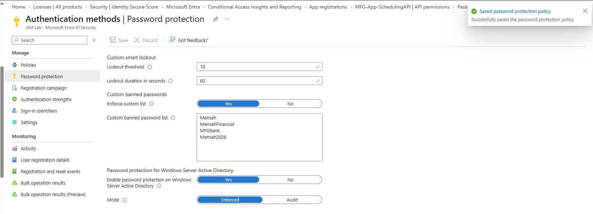

# Phase 2: Authentication and access control

[Back to main README](../README.md) | Previous: [Phase 1](../01-identity-foundation/README.md) | Next: [Phase 3: Hybrid identity](../03-hybrid-identity/README.md)

**Goal:** decide how MFG staff prove who they are, then control access with Conditional Access, rolled out safely in report-only mode so no policy could lock anyone out before it was checked against real sign-ins.

**Status:** Configuration complete for this phase; validation varies by component. Items marked *Configured* were set up but not tested end to end. Conditional Access, risk and Identity Protection evidence comes from the Microsoft 365 E5 trial, which ended on October 16, 2026.

## Summary of what was built

| Area | Result | Evidence status |
|---|---|---|
| Authentication methods | Passkey, Authenticator, Temporary Access Pass, software OATH and Email OTP on; SMS and voice off | Tested (policy page shown) |
| Terms of use | An acceptable use policy, configured through CA001 in report-only mode | Limited: not enforced; 6 sign-in events evaluated as requiring acceptance |
| Conditional Access | 7 policies, all report-only | Limited: evaluated in logs and What If; none enforced |
| Identity Protection | A user raised to High risk and confirmed compromised | Tested (remediation actions not shown) |
| Self-service password reset | Scoped to the `SG-Compliance` group | Configured |
| Password protection | Custom banned password list, enforced | Configured |

## 1. Authentication methods

The authentication methods policy controls which authentication methods are available for users to register and use, subject to each method's supported scenarios and configuration.

| Method | Enabled | Target |
|---|---|---|
| Passkey (FIDO2) | Yes | All users |
| Microsoft Authenticator | Yes | All users |
| Temporary Access Pass | Yes | All users |
| Software OATH tokens | Yes | All users |
| Email OTP | Yes | All users (see note below) |
| SMS, voice call, hardware OATH, certificate-based, Verified ID, QR code | No | n/a |

SMS and voice are off because they are less resistant to phishing and social engineering, and MFG has phishing-resistant options (passkeys) and app-based options available. Email OTP is enabled in the policy for all users. Microsoft treats email OTP differently for external users and for member users' password reset, and this lab did not test either use, so it should not be read as a general sign-in method for the workforce accounts. The Temporary Access Pass is a time-limited code an admin issues so a user can register their first strong method; it is how MFA was bootstrapped for the test account in [Phase 4](../04-privileged-access-and-governance/README.md). Its settings (1 hour minimum and default lifetime, 8 hour maximum, one-time use not required) are not shown in a screenshot here.

This screenshot shows the policy configuration. It does not show a passkey being registered or used to sign in, or any other method being used successfully.



## 2. Terms of use

The **MFG Acceptable Use Policy** (version 1.0) is a one-page document written for this lab. It covers the purpose of access, account security, data protection, monitoring, and what acceptance means. The document is in [`docs/MFG-Acceptable-Use-Policy.pdf`](docs/MFG-Acceptable-Use-Policy.pdf).

The policy is configured through Conditional Access policy `CA001`, currently in report-only mode. Sign-in logs showed six sign-in events that the policy evaluated as requiring Terms of use acceptance. Whether those were six distinct users was not checked. **The policy has not been enforced, and users have not been required to accept the terms as a condition of access.**

No screenshot of the Terms of use page is included.

## 3. Conditional Access in report-only mode

Conditional Access policies decide what is required (or blocked) when a user signs in, based on who they are, what they are accessing, and the risk of the sign-in. Report-only mode evaluates each policy against real sign-ins and logs what would have happened, without enforcing it.

| Policy | Intent | State |
|---|---|---|
| CA001 | Require Terms of use for all users | Report-only |
| CA002 | Block legacy authentication | Report-only |
| CA003 | Require MFA for admins | Report-only |
| CA004 | Require compliant device for admins | Report-only |
| CA005 | Block Android high-risk sign-ins | Report-only |
| CA006 | Require MFA at medium or higher sign-in risk | Report-only |
| CA007 | Require password change at high user risk | Report-only |

The two break-glass accounts from [Phase 1](../01-identity-foundation/README.md) are excluded from the policies so a policy error cannot lock the tenant. The exclusions are not shown in a screenshot, and the detailed targeting of each policy (included users and apps) is not shown beyond the names and the What If result below.


*Seven user-created policies, all Report-only, created on October 14 and 15, 2026.*

### What the logs showed

A KQL query over the sign-in logs counted each policy's report-only result over the last 24 hours. The query reads the `ConditionalAccessPolicies` column and keeps only results that start with `reportOnly`, so it shows report-only outcomes, not enforced ones. The screenshot is in [Phase 5](../05-monitoring-and-workload-identity/README.md).

```kusto
SigninLogs
| mv-expand cap = ConditionalAccessPolicies
| extend PolicyName = tostring(cap.displayName), PolicyResult = tostring(cap.result)
| where PolicyResult startswith "reportOnly"
| summarize Evaluations = count() by PolicyName, PolicyResult
| order by Evaluations desc
```

Each count is a number of sign-in evaluations, not a number of users.

| Policy | Expected | Observed (report-only) |
|---|---|---|
| CA001 Terms of use | Requires acceptance for sign-ins that have not accepted the terms | 6 report-only interruptions (sign-in events, not confirmed distinct users); 11 not applied |
| CA002 Block legacy authentication | No match, since no legacy sign-ins occurred | Not applied (17) |
| CA003 MFA for admins | Applies to admin sign-ins and succeeds when MFA is completed | 1 report-only success; 15 not applied |
| CA004 Compliant device for admins | Fails for an admin on a non-compliant device | 1 report-only failure; 15 not applied |
| CA005 Block Android high-risk | No match, since no Android high-risk sign-ins occurred | Not applied (16) |
| CA006 MFA at medium+ sign-in risk | No match, since no risky sign-ins occurred | Not applied (16) |
| CA007 Password change at high user risk | Applies to sign-ins by a user at high user risk | Not applied (16) in this window |

CA004 reports a failure here because the lab has no Intune, so no device can be marked compliant, and the evaluated admin sign-in came from a device that was not compliant. If enforced in this lab, the policy would block that admin sign-in, which is why it was kept in report-only mode. CA003 recorded one report-only success for an admin sign-in. [Phase 4](../04-privileged-access-and-governance/README.md) separately demonstrates PIM activation with MFA. Together, these exercises demonstrate two distinct aspects of privileged access security: Conditional Access evaluation and time-limited privileged role activation. None of these results is an enforcement test; the Conditional Access policies remained in report-only mode.

### Testing a scenario with What If

The What If tool evaluates which policies would apply to a hypothetical sign-in. The inputs were chosen to look like a risky sign-in: the user Kevin Tran, to Office 365 Exchange Online, from a browser on an Android device, at High sign-in risk.




*Two policies apply: CA001 (Terms of use) and CA005, whose grant control is **Block access**. Both are Report-only, so no sign-in is actually blocked.*

The What If simulation evaluated a hypothetical high-risk Android sign-in for Kevin Tran against the configured Conditional Access policies. CA001 (Terms of use) and CA005 (Block Android high-risk sign-ins) would apply, and CA005 is configured to block access. This demonstrates the intended policy behavior for the simulated scenario. Both policies are in report-only mode, so nothing was enforced against a real sign-in, and no real Android sign-in was made.

## 4. Identity Protection and a risky user

Identity Protection scores users and sign-ins for risk. The portal only lets an admin mark a user as compromised if the user is already in the Risky users list, so a clean user cannot be flagged through the portal. The Microsoft Graph `confirmCompromised` API was used instead on the test user **Dwayne Mitchell** (the IT consultant, a contractor), which put him in the list as High risk with the state **Confirmed compromised**.




*Risk state Confirmed compromised, risk level High, last updated October 16, 2026.*


*The details page shows the admin actions available: dismiss risk, confirm safe, reset password, revoke sessions, and block user. The timeline records "Admin confirmed user compromised", with the admin as the actor.*

Marking a user compromised sets a **user risk** state. It does not show that any sign-in was detected as risky, which is what **sign-in risk** (policy CA006) evaluates. CA007 evaluates user risk. The remediation actions are shown as available, but the screenshots do not show one being completed. In a policy-driven setup, CA007 would require this user to change their password at high user risk; it was in report-only mode and not enforced.

## 5. Self-service password reset

SSPR lets users reset their own passwords without calling the helpdesk. It is enabled only for the `SG-Compliance` group as a limited rollout. The page notes that administrators are always enabled for SSPR and must use two methods. Two methods are required for the group, and security questions are deliberately not used because they are weak and being retired. Those two settings are not shown in the screenshot below, and no password reset was run through SSPR.



## 6. Password protection

Smart lockout and a custom banned password list are configured to strengthen password security in the cloud. On-premises password protection is configured in the portal but has not been validated on the domain controller.

| Setting | Value |
|---|---|
| Smart lockout | Threshold: 10 attempts; duration: 60 seconds |
| Custom banned password list | Enforced for the configured cloud policy: `Mensah`, `MensahFinancial`, `MFGBank`, `Mensah2026` |
| On-premises AD password protection | Configured as Enforced in the portal; **not validated on the domain controller**, because the Entra Password Protection agents are not part of this lab's documented setup |

The first list entry, `MFG`, was rejected because each banned term must be at least four characters. `MFGBank` was used instead.

On-premises enforcement depends on the Domain Controller Agent being installed on the domain controllers that handle password changes. This phase does not cover that installation.



## Lessons from this phase

- **Report-only results are in the per-policy column.** The overall `ConditionalAccessStatus` showed "not applied" for the sign-ins checked here; the per-policy report-only results are in `ConditionalAccessPolicies` ([Phase 5](../05-monitoring-and-workload-identity/README.md)).
- **A compliant-device policy needs a working compliance path.** Without a configured and validated device-compliance solution, the lab's admin sign-in evaluated as non-compliant. Enforcing CA004 without first establishing a compliant-device path could block legitimate admin access.
- **The portal cannot flag a clean user as compromised.** The Graph `confirmCompromised` API was used for the demonstration.
- **The portal rejected `MFG` as too short** (each word must be at least 4 characters); `MFGBank` was accepted instead.
- **Break-glass exclusions must be verified on each policy,** not only configured in principle. Every policy that could block admins must exclude the emergency accounts.
