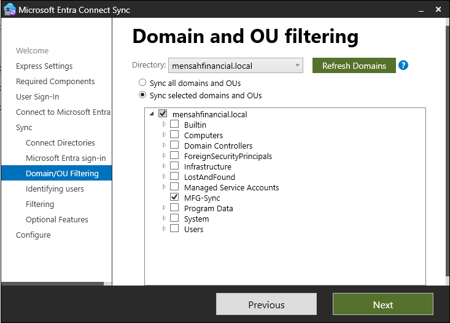
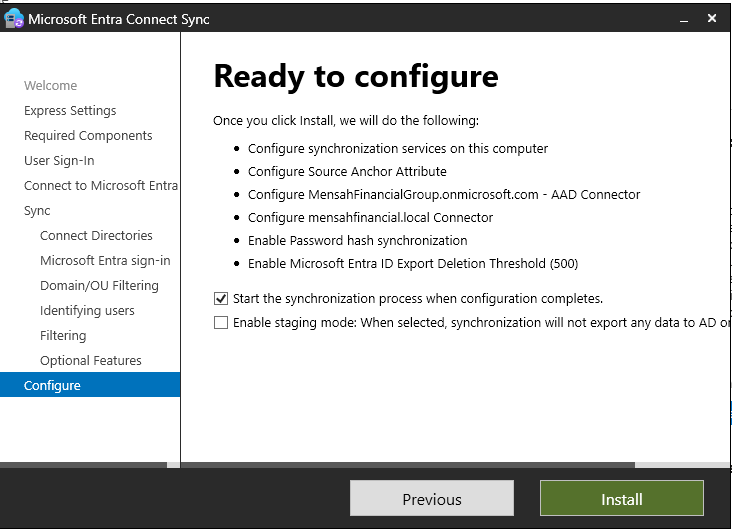
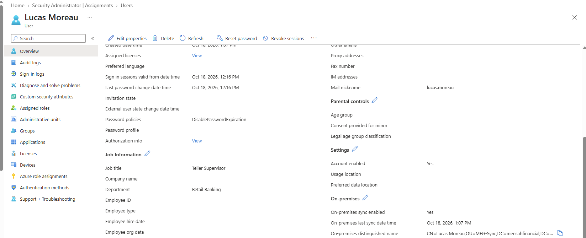
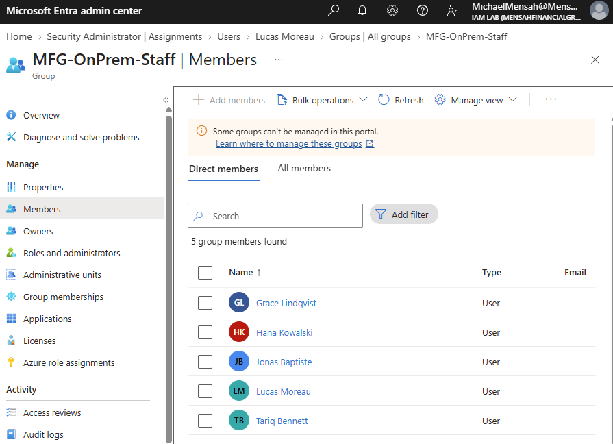
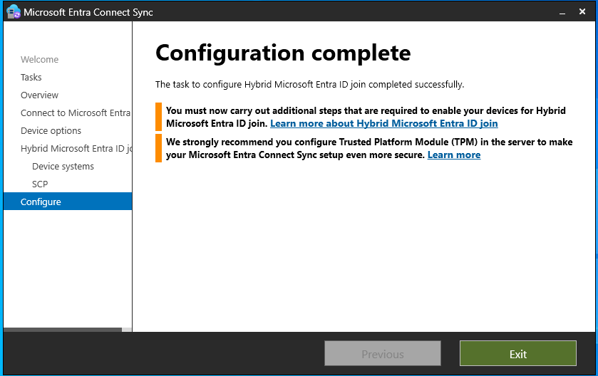
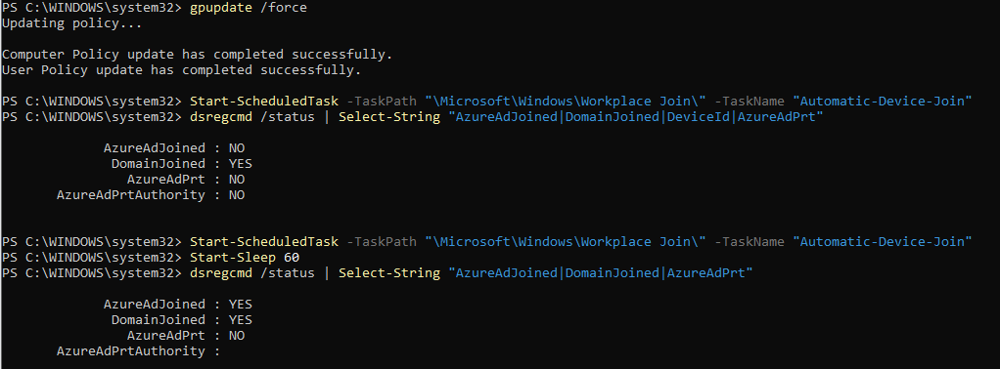
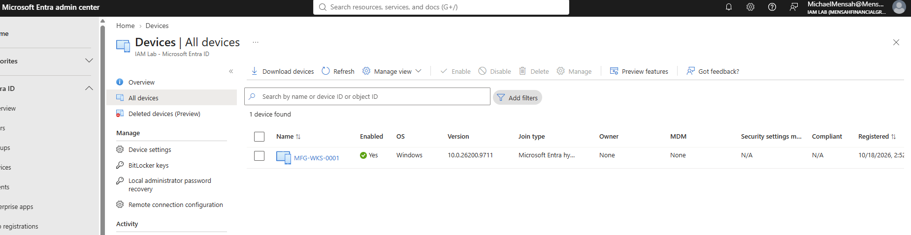

# Phase 3: Hybrid identity

[Back to main README](../README.md) | Previous: [Phase 2](../02-authentication-and-access/README.md) | Next: [Phase 4: Privileged access and governance](../04-privileged-access-and-governance/README.md)

**Goal:** connect MFG's on-premises Active Directory (`mensahfinancial.local`) to Microsoft Entra ID, synchronize a small, deliberately scoped set of users and a group, and register the domain-joined workstation with Entra ID as a hybrid joined device.

**Status:** Configuration complete for this phase; validation varies by component. Synchronization and hybrid join were verified. A password-hash sign-in as a synced user and the user's Primary Refresh Token were not verified. This phase does not depend on the P2 trial; Entra Connect Sync and hybrid join work on the Free tier.

## Summary of what was built

| Area | Result | Evidence status |
|---|---|---|
| Directory preparation | Alternate UPN suffix added to the forest; a dedicated `MFG-Sync` OU with 5 test users and a group | Configured |
| Entra Connect Sync | Installed with password hash sync, source anchor `ms-DS-ConsistencyGuid`, and sync scope limited to the `MFG-Sync` OU | Tested (configuration screens shown) |
| User and group sync | 5 users and the group `MFG-OnPrem-Staff` appear in Entra ID | Tested |
| Hybrid Entra join | `MFG-WKS-0001` shows as Microsoft Entra hybrid joined | Tested |
| Password hash sync sign-in | Enabled; no cloud sign-in as a synced user was run | Not verified |
| Primary Refresh Token (PRT) | `AzureAdPrt` is still `NO` | Not verified |

## 1. Prepare the on-premises directory

**The UPN suffix.** The domain `mensahfinancial.local` cannot be verified as a public domain (see [Phase 0](../00-environment-setup/README.md)), so users synchronized from it would otherwise get a non-routable sign-in name. The tenant's `onmicrosoft.com` domain was added to the forest as an alternate UPN suffix, so synced users can have a sign-in name the cloud accepts. Adding the suffix only makes it available; it does not change any existing user's UPN, so the users' UPNs were set to this suffix. This was checked for Lucas Moreau: `Get-ADUser lucas.moreau -Properties UserPrincipalName` on the domain controller returns `lucas.moreau@MensahFinancialGroup.onmicrosoft.com`, which matches his sign-in name in Entra ID. The other four users were not individually checked.

**A scoped OU.** A dedicated organizational unit, `MFG-Sync`, was created to hold everything meant to synchronize. Five test users and the group `MFG-OnPrem-Staff` were placed in it. Only this OU would be in the sync scope.

Commands run on the domain controller:

```powershell
Set-ADForest -Identity (Get-ADForest).Name -UPNSuffixes @{Add="MensahFinancialGroup.onmicrosoft.com"}
New-ADOrganizationalUnit -Name "MFG-Sync" -Path "DC=mensahfinancial,DC=local" -ProtectedFromAccidentalDeletion $false
```

The five users (Grace Lindqvist, Hana Kowalski, Jonas Baptiste, Lucas Moreau and Tariq Bennett) were created with `New-ADUser` and added to `MFG-OnPrem-Staff` with `Add-ADGroupMember`. These commands are not reproduced here.

## 2. Install Microsoft Entra Connect Sync

Microsoft Entra Connect Sync was installed with the **customize** option and these choices:

- **Password hash synchronization** as the sign-in method. Hashes of the on-premises password hashes are synchronized so users can sign in to cloud services with the same password.
- **OU filtering:** only `MFG-Sync` is selected. The wizard first showed other containers selected (the domain root and Managed Service Accounts); these were cleared so only the lab OU synchronizes.
- **Source anchor `ms-DS-ConsistencyGuid`:** used to maintain the link between each synchronized on-premises user and its corresponding Microsoft Entra object.
- **A new dedicated connector account.** The wizard needs an account in the on-premises directory to read and sync. When an existing administrator was supplied, the wizard warned against it, so **Create new account** was chosen. The wizard created a service account (`MSOL_...`) with only the permissions it needs. Creating it required a one-time Enterprise Admin credential (`MFG\Administrator`), which is not used for synchronization afterwards.


*Only `MFG-Sync` is selected under `mensahfinancial.local`.*


*The wizard's summary: the Entra and AD connectors for `MensahFinancialGroup.onmicrosoft.com` and `mensahfinancial.local`, the source anchor, password hash synchronization, and the export deletion threshold of 500. "Start the synchronization process when configuration completes" is selected.*

Microsoft's wizard shows a banner suggesting a transition to **Cloud Sync**, its newer lightweight agent. Entra Connect Sync was used here because it is the established model and, in the same wizard, configures hybrid join.

## 3. Verify the synchronization

A synchronization cycle was run on the domain controller and the scheduler checked:

```powershell
Start-ADSyncSyncCycle -PolicyType Delta
Get-ADSyncScheduler
```

The results appear in the Entra admin center. A synced user shows **On-premises sync enabled: Yes**, the time of the last sync, and the on-premises distinguished name, which includes `OU=MFG-Sync`. The synced group shows members in the portal, with a banner explaining that groups synchronized from on-premises cannot be managed in the cloud portal.


*Lucas Moreau (Teller Supervisor, Retail Banking): On-premises sync enabled, last sync October 18, 2026, distinguished name under `OU=MFG-Sync`.*


*`MFG-OnPrem-Staff` with its 5 members.*

## 4. Hybrid Entra join the workstation

Hybrid join registers a domain-joined Windows device with Entra ID, so the device has an identity in both directories.

1. In Entra Connect's **Configure device options**, hybrid Microsoft Entra ID join was configured for the Windows devices in the domain. This publishes a **service connection point (SCP)** in Active Directory that tells domain-joined devices which tenant to register with.
2. The workstation's computer account was moved into `MFG-Sync`, because only objects in the sync scope synchronize. (`MFG-DC01` was not moved, so it is not synced or registered.)
3. After a Group Policy refresh, the automatic device-join scheduled task was run on the workstation.

```powershell
# On the domain controller
Get-ADComputer MFG-WKS-0001 | Move-ADObject -TargetPath "OU=MFG-Sync,DC=mensahfinancial,DC=local"

# On the workstation
gpupdate /force
Start-ScheduledTask -TaskPath "\Microsoft\Windows\Workplace Join\" -TaskName "Automatic-Device-Join"
dsregcmd /status | Select-String "AzureAdJoined|DomainJoined|AzureAdPrt"
```


*The wizard reports that hybrid join configuration completed successfully. It also notes that additional steps are needed on devices and recommends a TPM on the server.*


*Before the task ran: `AzureAdJoined : NO`, `DomainJoined : YES`. After running the task and waiting 60 seconds: `AzureAdJoined : YES`, `DomainJoined : YES`. `AzureAdPrt` is `NO` in both.*


*`MFG-WKS-0001` appears under All devices as Enabled, with join type **Microsoft Entra hybrid joined**. Owner and MDM show None, and Compliant is N/A.*

## What is not verified

- **PRT.** The Primary Refresh Token is acquired when a user signs in to a hybrid joined device with a cloud-synced identity. `AzureAdPrt` is `NO`. The cause of the `NO` result was not investigated further. A sign-in by a synced user remains an outstanding validation step. Device registration and the user's cloud single sign-on state are separate things, and only the first is shown here.
- **Password hash sync sign-in.** Hash synchronization is enabled, but no sign-in to a cloud service as a synced user was run.
- **Compliance.** **Compliant** shows N/A and **MDM** shows None because the lab has no Intune. Hybrid join does not require it.

To close the PRT gap, sign in to the workstation as a synced user (for example `MFG\lucas.moreau`) and run `dsregcmd /status | Select-String AzureAdPrt`.

## Lessons from this phase

- **Scope the sync from the start.** The wizard's OU filtering initially had more containers ticked than intended. Check the filtering page before moving on.
- **Do not hand the wizard a domain administrator as the connector account.** Let it create a dedicated `MSOL_` account.
- **Objects must be in the sync scope to sync.** The workstation was only registered after its computer account moved into `MFG-Sync`.
- **Keep the lab's synchronization scope intentional.** `MFG-DC01` was excluded from the sync scope and does not appear in Entra Devices.
- **Hybrid join takes a task run and a short wait.** Running the scheduled task and waiting about a minute turned `AzureAdJoined` from `NO` to `YES`.
- **AD cmdlets run where the module is installed.** `Get-ADComputer` was not available on the workstation, so it ran on the domain controller.
- **The Entra Connect installer is in the Entra admin center** (Entra Connect, Get started, Manage), not on the Microsoft Download Center.
