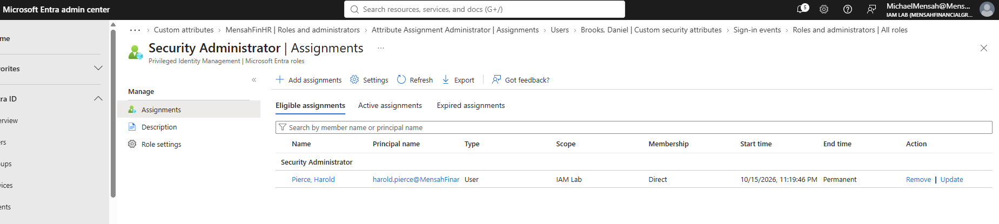
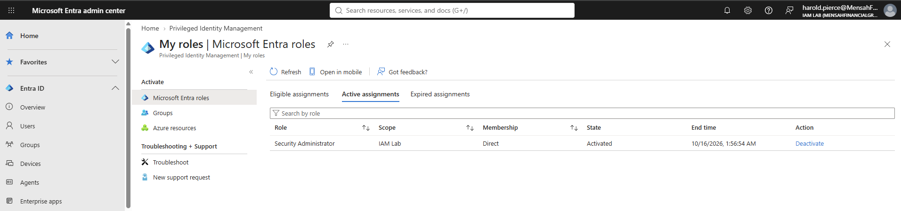
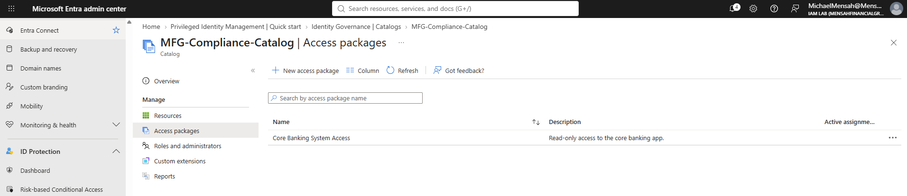

# Phase 4: Privileged access and governance

[Back to main README](../README.md) | Previous: [Phase 3](../03-hybrid-identity/README.md) | Next: [Phase 5: Monitoring and workload identity](../05-monitoring-and-workload-identity/README.md)

**Goal:** make administrator access temporary and justified instead of permanent, and give staff a governed way to request access to an application.

**Status:** Configuration complete for this phase; validation varies by component. A PIM role activation was performed and captured. The entitlement management access package was built, but a request, approval and expiry were not demonstrated. The tenant had access to both features through the Microsoft 365 E5 trial, which ended on October 16, 2026, so the evidence was captured then. Licensing requirements differ by feature and change over time; check Microsoft's current documentation before relying on this lab for licensing decisions.

## Summary of what was built

| Area | Result | Evidence status |
|---|---|---|
| Privileged Identity Management (PIM) | `Security Administrator` made eligible (not permanent) for Harold Pierce | Tested |
| Role activation | Harold activated the role and it showed as Activated with an end time | Tested (the PIM audit-log view was not captured) |
| Entitlement management | Catalog `MFG-Compliance-Catalog` with the access package `Core Banking System Access` | Configured |
| Access package lifecycle | Request, approval, assignment and expiry | Not verified |

## 1. Privileged Identity Management

PIM changes administrator roles from *always on* to *eligible*. A user who is eligible holds no administrator rights day to day. They must activate the role when they need it, and the activation is time-limited.

Harold Pierce was given an **eligible** assignment to the `Security Administrator` role, scoped to the whole tenant (IAM Lab).

*Security Administrator, Eligible assignments: Harold Pierce, direct membership, start 10/15/2026 11:19:46 PM. The **End time** column reads Permanent, which means the eligibility itself does not expire; the access it grants does, once the role is activated.*

Harold then signed in as himself and activated the role from **My roles**. While the role was active, it showed under Active assignments with the state **Activated** and an end time.

*Harold's My roles, Active assignments: Security Administrator, state Activated, end time 10/16/2026 1:56:54 AM. A **Deactivate** action is available before that time.*

Temporary Access Pass was used to give Harold a strong sign-in method to register first (see [Phase 2](../02-authentication-and-access/README.md)). The role's activation settings (maximum duration, whether MFA, justification or approval is required) are not shown in a screenshot, so this phase does not claim any specific setting beyond what the screenshots show: the role was activated, and it was active only until the end time displayed.

PIM keeps a history of eligible assignments, activations and expirations in its audit view. That view was not captured, so there is no screenshot here of the activation as a logged event.

### A note on the author's own account and break-glass accounts

PIM was applied to this test user. The two break-glass accounts and the author's own administrator account are **permanent** Global Administrators (see [Phase 1](../01-identity-foundation/README.md)). Break-glass accounts are permanent on purpose, so they work when PIM or Conditional Access cannot. The author's own permanent assignment is a lab simplification, and a production tenant would make that role eligible as well.

## 2. Entitlement management

Entitlement management lets users request access to a bundle of resources, instead of an admin adding them by hand, and lets that access expire. It is built from three parts:

| Part | What it is | In this lab |
|---|---|---|
| Catalog | A container of resources that can be offered | `MFG-Compliance-Catalog` |
| Access package | The bundle of access a user can request, with the policy for who can ask and for how long | `Core Banking System Access` (description: "Read-only access to the core banking app.") |
| Request and assignment | A user asks, an approver decides, the access is granted and later removed | Not demonstrated |

*`MFG-Compliance-Catalog` with one access package, `Core Banking System Access`. The Active assignments column does not show a count.*

The screenshot shows that the catalog and the access package exist. It does not show the package's resources, its request policy (who can request, whether approval is needed), or its expiry settings, and no request was submitted through it. This phase therefore documents that the governance structure was **configured**, not that the approval-and-expiry workflow was **tested**. The next validation step would be to configure the package's resources and request policy, submit a request as an eligible user, complete the approval, and verify that the assignment expires as configured.

## What is not verified

- **PIM audit history.** The activation is shown in the user's My roles view only. The audit log entry was not captured.
- **PIM role settings.** Activation duration, MFA, justification and approval requirements were not captured.
- **Access package lifecycle.** No access request, approval, assignment or expiry was demonstrated, and the package's policy is not shown.
- **Access reviews.** Access reviews are part of the licensing described in the main README, but this phase has no review evidence, so none is claimed.

## Lessons from this phase

- **Use eligible assignments for just-in-time access.** A permanent active assignment already grants the role, so it does not provide the activation step demonstrated here. PIM eligibility lets a user activate the role only when needed.
- **Eligible does not mean temporary eligibility.** The assignment here is permanently eligible; the time limit is on each activation, not on the eligibility.
- **A new user has no strong sign-in method.** Harold needed one registered (using a Temporary Access Pass) before the privileged activation could be performed as him.
- **Build the lifecycle, not only the container.** A catalog and a package are only structure. The value of entitlement management is the request, approval and expiry path, which still needs an end-to-end test.
- **Capture the audit trail when you demonstrate a privileged action.** The activation was visible to the user, but the log of it was not saved.
