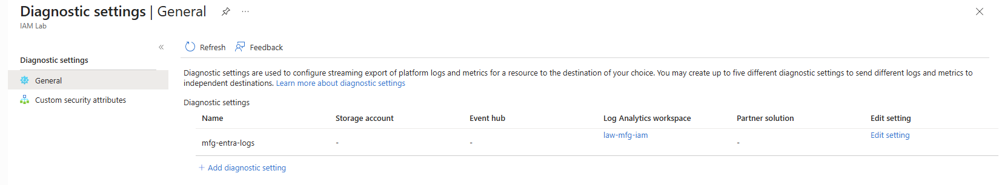
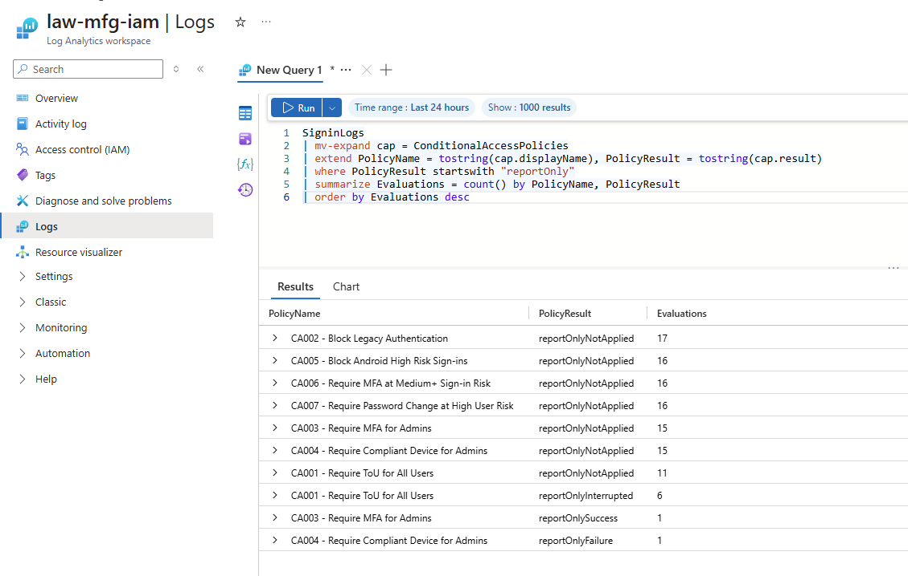
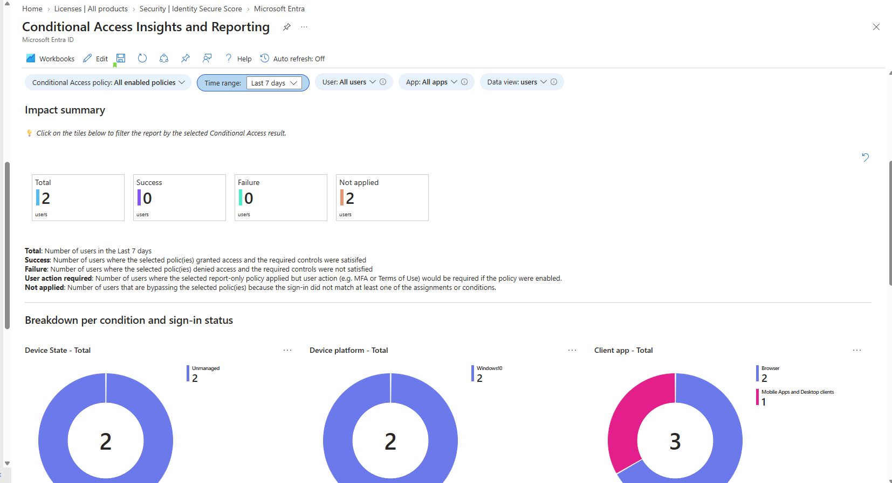
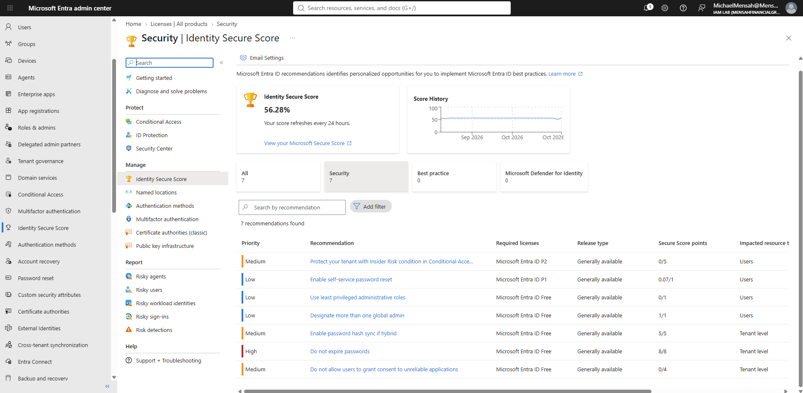
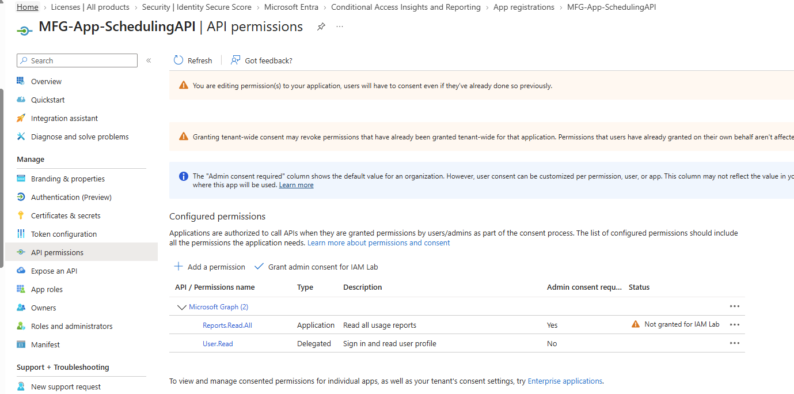
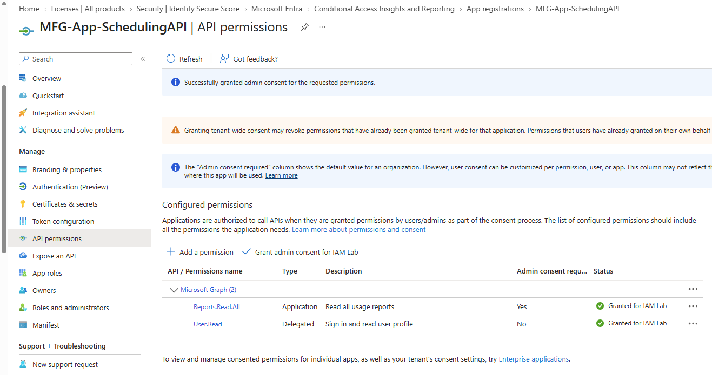
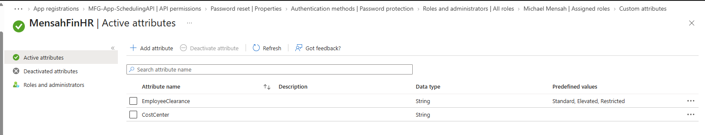

# Phase 5: Monitoring and workload identity

[Back to main README](../README.md) | Previous: [Phase 4: Privileged access and governance](../04-privileged-access-and-governance/README.md)

**Goal:** send Entra ID sign-in logs to a Log Analytics workspace so the Conditional Access policies from [Phase 2](../02-authentication-and-access/README.md) can be checked against real sign-ins, review the tenant's security posture, and register an application identity with a deliberately granted permission.

**Status:** Configuration complete for this phase; validation varies by component. Log export, the KQL query, the workbook, Identity Secure Score and the app consent are shown in screenshots. Custom security attribute **values could not be assigned** and that item is unresolved. A managed identity and Key Vault demonstration was planned and dropped (see the end of this page). The Conditional Access evidence was captured while the Microsoft 365 E5 trial was active; the trial ended on October 16, 2026.

## Summary of what was built

| Area | Result | Evidence status |
|---|---|---|
| Log export | Diagnostic setting `mfg-entra-logs` sends Entra logs to the Log Analytics workspace `law-mfg-iam` | Tested (setting shown) |
| KQL | A query returns each Conditional Access policy's report-only result from the sign-in logs | Tested |
| Conditional Access insights workbook | Opened over the last 7 days | Limited: filtered to enabled policies; does not show the report-only outcomes |
| Identity Secure Score | 56.28%, with 7 recommendations | Tested (read-only review; no recommendation was acted on in this phase) |
| App registration and consent | `MFG-App-SchedulingAPI`: `Reports.Read.All` (application) shown as not granted, then admin consent granted | Tested |
| Custom security attributes | Attribute set `MensahFinHR` with two attributes defined | Limited: assigning values failed |

## 1. Send Entra logs to Log Analytics

Sign-in and audit logs stay in Entra ID for a limited time and are awkward to query across many events. A **diagnostic setting** exports them to a **Log Analytics workspace**, where they can be queried with Kusto Query Language (KQL) and kept for as long as the workspace is configured to keep them.

A workspace named `law-mfg-iam` receives the logs through a diagnostic setting named `mfg-entra-logs`. The screenshot shows the Log Analytics workspace as the only destination. It does not show which log categories are selected, so this README does not list them; the query below reads the sign-in logs, and it returned data, which confirms those logs are arriving.


*Diagnostic settings: `mfg-entra-logs` with destination `law-mfg-iam` (no storage account, event hub or partner solution).*

## 2. Query Conditional Access results with KQL

Phase 2's Conditional Access policies were all in report-only mode. To examine each policy's report-only outcome, the query reads the `ConditionalAccessPolicies` column, which contains an entry for each policy evaluated during a sign-in. It expands those entries into individual rows and keeps results beginning with `reportOnly`. This distinguishes policies that would succeed, fail, interrupt the user, or not apply, without implying that any policy was enforced. (The overall `ConditionalAccessStatus` column showed "not applied" for the sign-ins checked in this lab, so it was not used.)

```kusto
SigninLogs
| mv-expand cap = ConditionalAccessPolicies
| extend PolicyName = tostring(cap.displayName), PolicyResult = tostring(cap.result)
| where PolicyResult startswith "reportOnly"
| summarize Evaluations = count() by PolicyName, PolicyResult
| order by Evaluations desc
```


*Time range: last 24 hours. Each row counts sign-in evaluations of a policy, not users.*

The results are interpreted policy by policy in [Phase 2](../02-authentication-and-access/README.md#what-the-logs-showed). In short: CA001 recorded 6 `reportOnlyInterrupted` (a user action, the Terms of use, would be required) and 11 `reportOnlyNotApplied`; CA003 recorded 1 `reportOnlySuccess`; CA004 recorded 1 `reportOnlyFailure`; and CA002, CA005, CA006 and CA007 were only ever not applied. Nothing in this output means a policy was enforced.

## 3. Conditional Access insights and reporting workbook

The Conditional Access **Insights and Reporting** workbook gives a visual summary of how policies would affect sign-ins. It was opened over the last 7 days with the policy filter set to **All enabled policies**.


*Impact summary, last 7 days: 2 users total, 0 success, 0 failure, 2 not applied. Breakdowns show 2 unmanaged devices, 2 Windows 10 sign-ins and 3 client-app sign-ins (browser and mobile or desktop clients).*

This view and the KQL results measure different things. The workbook counts **users** over 7 days; the KQL query counts **sign-in evaluations** over 24 hours. Because the workbook was filtered to **All enabled policies**, this screenshot does not provide evidence of the report-only outcomes shown by the KQL query. The reason the workbook's totals differ from the query results was not investigated further, so the two views are presented separately and not treated as directly comparable. The query is the evidence this README relies on for report-only behaviour.

## 4. Identity Secure Score

Identity Secure Score is Microsoft's measure of how closely the tenant follows Entra ID security recommendations. It refreshes every 24 hours.


*Score 56.28%, with a flat score history from September to October 2026 and 7 recommendations.*

| Priority | Recommendation | Points | Licence listed |
|---|---|---|---|
| High | Do not expire passwords | 8/8 | Entra ID Free |
| Medium | Enable password hash sync if hybrid | 5/5 | Entra ID Free |
| Low | Designate more than one global admin | 1/1 | Entra ID Free |
| Low | Enable self-service password reset | 0.07/1 | Entra ID P1 |
| Low | Use least privileged administrative roles | 0/1 | Entra ID Free |
| Medium | Do not allow users to grant consent to unreliable applications | 0/4 | Entra ID Free |
| Medium | Protect your tenant with Insider Risk condition in Conditional Access | 0/5 | Entra ID P2 |

The points line up with decisions made in this lab: password hash sync is on ([Phase 3](../03-hybrid-identity/README.md)), more than one Global Administrator exists (the two break-glass accounts and the author's account, [Phase 1](../01-identity-foundation/README.md)) and SSPR is enabled for one group only ([Phase 2](../02-authentication-and-access/README.md)), which may explain its partial credit. The exact scoring calculation was not investigated. The lowest-scoring items are the clearest gaps: the lab does not restrict user consent to applications, the author's own account is a permanent Global Administrator rather than a least-privileged or eligible assignment, and the Insider Risk recommendation needs P2, which the tenant no longer has. This phase did not act on any recommendation, so the 56.28% is a dated snapshot of the tenant at the time of review, not a current score and not evidence that the lab improved security.

## 5. Workload identity: an app registration and consent

A **workload identity** is the identity an application uses instead of a person. Registering an app creates one in the tenant. The app `MFG-App-SchedulingAPI` was registered for a fictional scheduling service and given two Microsoft Graph permissions:

| Permission | Type | Meaning | Admin consent required |
|---|---|---|---|
| `Reports.Read.All` | Application | The app, signed in as itself with no user present, can read all usage reports | Yes |
| `User.Read` | Delegated | The app can sign in a user and read that user's profile | No |

Application permissions are powerful because they act without a signed-in user, which is why they always need an administrator's consent. Before consent, the portal showed `Reports.Read.All` with the status **Not granted for IAM Lab**:


*The warning banner notes that editing permissions requires users to consent again. `Reports.Read.All` shows Not granted; `User.Read` shows no status.*

An administrator then selected **Grant admin consent for IAM Lab**. The portal confirmed the grant, and both permissions show **Granted for IAM Lab**. `User.Read` was granted in the same step and did not need separate admin consent.


*"Successfully granted admin consent for the requested permissions." Both permissions show a green Granted for IAM Lab status.*

The screenshots demonstrate the permission-consent workflow: `Reports.Read.All` was initially ungranted and was then granted by an administrator, with `User.Read` granted in the same operation. They do not demonstrate token acquisition or API access. The app was not used to call the API, and no client secret or certificate is documented here.

## 6. Custom security attributes

Custom security attributes are tenant-defined key-value tags that can be attached to users or applications, for example to drive access decisions or reporting. They need their own role to manage, separate from the usual administrator roles.

An attribute set named `MensahFinHR` was created with two attributes:

| Attribute | Data type | Predefined values |
|---|---|---|
| `EmployeeClearance` | String | `Standard`, `Elevated`, `Restricted` |
| `CostCenter` | String | None (free text) |


*`MensahFinHR` Active attributes: `EmployeeClearance` with three predefined values, and `CostCenter`.*

**Not resolved:** assigning values to a user's custom security attributes failed with an "insufficient privileges" error (reported as error 530035). The attribute set and definitions were created, but no value was saved to a user. Microsoft documents the **Attribute Assignment Administrator** role as the minimum role for assigning custom security attribute values; Global Administrator does not automatically grant this permission. This is a plausible explanation for the failure, but it was not confirmed in this lab. The assignment was not successfully retried, so this README claims only that the attribute set and definitions were created.

## What is not verified

- **Custom attribute values.** No value was assigned to any user or application; see above.
- **Report-only results in the workbook.** The workbook screenshot does not show them; the KQL query does.
- **Secure Score improvement.** No recommendation was acted on, so no before-and-after is shown.
- **App usage.** The registered app was not used to request a token or call Microsoft Graph.
- **Log categories and retention.** Which log categories are exported and how long the workspace keeps them are not shown.

## Planned but not completed

A **managed identity** accessing an Azure **Key Vault** was planned as a second workload identity example. It was dropped when the Azure subscription ended, so there is no managed identity or Key Vault evidence in this lab. The app registration above is the only workload identity demonstrated.

## Lessons from this phase

- **Read the per-policy column for report-only results.** `ConditionalAccessPolicies` holds an entry for each policy evaluated in a sign-in, including report-only outcomes; the overall status column showed "not applied" here.
- **Different views count different things.** Users over 7 days in a workbook and sign-in evaluations over 24 hours in KQL are not comparable numbers. State the unit and the time range with every figure.
- **Application permissions need an administrator's consent on purpose.** Review which permission type an app is asking for before granting it.
- **Defining a custom attribute is not the same as being able to assign it.** Creating a set and assigning values use separate permissions.
- **Secure Score shows policy choices, not just settings.** The same lab decisions (permanent admin account, open user consent) show up as lost points.
